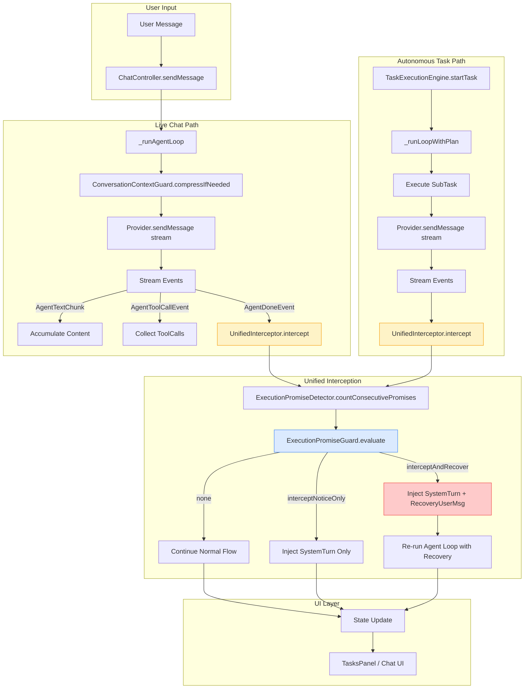
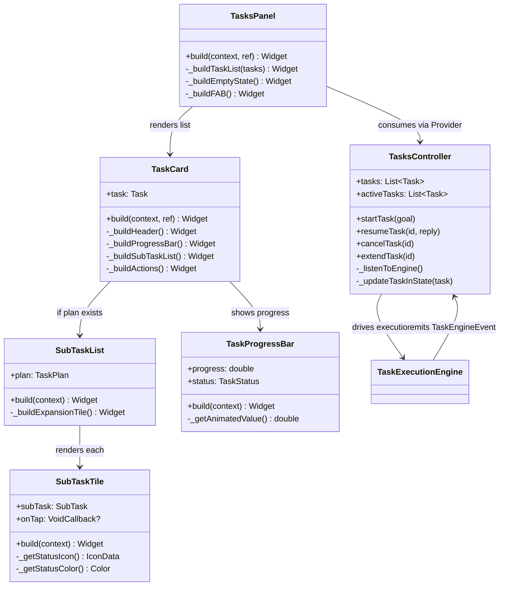
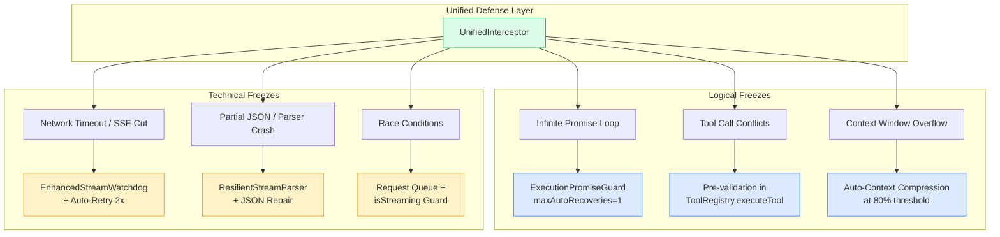

# خطة تنفيذ حارس الوعود (ExecutionPromiseDetector) + واجهة المهام العصرية + الفحص الشامل للتجمد

## 1. تحليل فجوة المسار (Pipeline Gap Analysis)

### المشكلة الحالية
- **`ExecutionPromiseDetector`** يعمل في المسار المستقل (`task_execution_engine.dart` → `_shouldRecoverFromPromiseLoop`) عبر فحص `history` المحلي داخل حلقة التنفيذ
- **المحادثة الحية** (`chat_controller.dart` → `_runAgentLoop`) تمر بمسار مختلف تماماً: تستقبل `stream` من الـ provider، تجمع الرد، ثم في النهاية تستدعي `_tryApplyExecutionPromiseGuard` **فقط إذا لم تكن هناك toolCalls** (السطر 808-818)
- **الفجوة**: الحارس في المحادثة الحية يعمل **بعد** انتهاء البث (post-hoc)، بينما في المهام المستقلة يعمل **أثناء** البث (inline). النتيجة: في المحادثة الحية، الرد يصل للمستخدم قبل الاعتراض.

### نقاط الاعتراض الحالية (Interception Points)

| المسار | نقطة الاعتراض | التوقيت |
|----------|----------------|---------|
| **المهام المستقلة** (`task_execution_engine.dart`) | `_executeSubTask` / `_runClassicLoop` → `_shouldRecoverFromPromiseLoop` | **أثناء** الحلقة (بعد كل دور مساعد) |
| **المحادثة الحية** (`chat_controller.dart`) | `_runAgentLoop` → `_tryApplyExecutionPromiseGuard` | **بعد** انتهاء البث الكامل (`completer.future`) |

---

## 2. التصميم الموحد: Unified Interception Pipeline

### المبدأ الأساسي
**نقطة اعتراض واحدة موحدة** تمر بها **كل ردود النموذج** بغض النظر عن المسار، **فور انتهاء دور المساعد** وقبل وصول أي شيء للمستخدم.

### البنية المقترحة

```
┌─────────────────────────────────────────────────────────────────┐
│                    UnifiedInterceptor                            │
├─────────────────────────────────────────────────────────────────┤
│  + interceptAssistantTurn(messages, assistantMsg, toolCalls)    │
│       │                                                         │
│       ├─▶ ExecutionPromiseDetector.countConsecutivePromises()   │
│       ├─▶ ExecutionPromiseGuard.evaluate()                      │
│       └─▶ Returns: InterceptionAction { none, interceptAndRecover, interceptNoticeOnly }
└─────────────────────────────────────────────────────────────────┘
                              │
              ┌───────────────┼───────────────┐
              ▼               ▼               ▼
    ┌─────────────────┐ ┌─────────────┐ ┌─────────────────┐
    │  Live Chat Path │ │ Autonomous  │ │  Resume Task    │
    │  (chat_controller)│ │ Task Engine │ │  (chat_controller)│
    └─────────────────┘ └─────────────┘ └─────────────────┘
```

### تنفيذ `UnifiedInterceptor` كخدمة جديدة

```dart
// lib/features/chat/presentation/utils/unified_interceptor.dart

enum InterceptionTiming {
  /// الاعتراض أثناء البث (للأدوات التي تُنفذ تدريجياً)
  duringStream,
  /// الاعتراض بعد اكتمال دور المساعد كاملاً (الوضع الافتراضي)
  postAssistantTurn,
}

class UnifiedInterceptor {
  /// نقطة الاعتراض الموحدة — تُستدعى فور انتهاء دور مساعد (نص + أدوات)
  static InterceptionResult intercept({
    required List<ChatMessage> conversationHistory,
    required ChatMessage assistantMessage,
    required List<ToolCallInfo> toolCalls,
    required int promiseRecoveryAttempt,
    InterceptionTiming timing = InterceptionTiming.postAssistantTurn,
  }) {
    // 1. فحص العداد الحقيقي من التاريخ
    final consecutive = ExecutionPromiseDetector.countConsecutivePromises(conversationHistory);
    
    // 2. تقييم الحارس
    final action = ExecutionPromiseGuard.evaluate(
      messages: conversationHistory,
      assistantMsgId: assistantMessage.id,
      assistantContent: assistantMessage.content,
      toolCalls: toolCalls,
      promiseRecoveryAttempt: promiseRecoveryAttempt,
    );
    
    return InterceptionResult(
      action: action,
      consecutiveCount: consecutive,
      shouldInjectSystemTurn: action != ExecutionPromiseGuardAction.none,
      shouldInjectRecoveryUserMessage: action == ExecutionPromiseGuardAction.interceptAndRecover,
    );
  }
}
```

---

## 3. خطة الدمج في المسار الحي (Live Chat Integration)

### التعديلات المطلوبة في `chat_controller.dart`

#### أ. استدعاء الحارس **أثناء** البث (Streaming Interception)
بدلاً من الانتظار لـ `completer.future`، نراقب `AgentDoneEvent` ونفحص فوراً:

```dart
// داخل _runAgentLoop، في معالج الأحداث:
} else if (event is AgentDoneEvent) {
  // ── نقطة الاعتراض الموحدة هنا ──
  final interception = UnifiedInterceptor.intercept(
    conversationHistory: conversationHistory,
    assistantMessage: ChatMessage(
      id: assistantMsgId,
      role: MessageRole.assistant,
      content: currentAssistantContent,
      timestamp: DateTime.now(),
      toolCalls: toolCalls.isNotEmpty ? toolCalls : null,
    ),
    toolCalls: toolCalls,
    promiseRecoveryAttempt: promiseRecoveryAttempt,
  );
  
  if (interception.action != ExecutionPromiseGuardAction.none) {
    // حقن SystemTurn + Recovery message فوراً
    await _applyInterception(interception, assistantMsgId, ...);
    if (interception.action == ExecutionPromiseGuardAction.interceptAndRecover) {
      // إعادة تشغيل الحلقة مع رسالة الاسترداد
      await _runAgentLoop(withRecovery, promiseRecoveryAttempt: promiseRecoveryAttempt + 1);
      return;
    }
  }
  
  if (!completer.isCompleted) completer.complete();
}
```

#### ب. توحيد `_tryApplyExecutionPromiseGuard` لاستخدام `UnifiedInterceptor`
```dart
Future<bool> _tryApplyExecutionPromiseGuard({...}) async {
  final interception = UnifiedInterceptor.intercept(
    conversationHistory: state.messages,
    assistantMessage: ChatMessage(...),
    toolCalls: toolCalls,
    promiseRecoveryAttempt: promiseRecoveryAttempt,
  );
  // تطبيق النتيجة...
}
```

---

## 4. واجهة المهام العصرية (Modern Tasks UI)

### 4.1 التصميم المعماري (Architecture)

```
┌────────────────────────────────────────────────────────────────┐
│                      TasksPanel (StatefulWidget)               │
├────────────────────────────────────────────────────────────────┤
│  Consumer<TasksState>                                          │
│       │                                                        │
│       ├─▶ TasksListView (ListView.builder)                     │
│       │       │                                                │
│       │       ├─▶ TaskCard (AnimatedContainer)                 │
│       │       │       │                                        │
│       │       │       ├─▶ TaskHeader (Goal, Status Badge)      │
│       │       │       ├─▶ ProgressIndicator (LinearProgress)   │
│       │       │       ├─▶ SubTaskList (ExpansionTile)          │
│       │       │       │       └─▶ SubTaskTile (status icon)    │
│       │       │       └─▶ TaskActions (Approve/Extend/Cancel)  │
│       │       │                                                │
│       │       └─▶ EmptyState / LoadingState                    │
│       │                                                        │
│       └─▶ FloatingActionButton (New Task)                      │
└────────────────────────────────────────────────────────────────┘
```

### 4.2 مكونات UI المقترحة

| المكون | الملف | الوصف |
|----------|-------|--------|
| `TasksPanel` | `lib/features/agent/presentation/widgets/tasks_panel.dart` | اللوحة الرئيسية، تستمع لـ `tasksProvider` |
| `TaskCard` | `lib/features/agent/presentation/widgets/task_card.dart` | بطاقة مهمة واحدة مع Glassmorphism |
| `SubTaskList` | `lib/features/agent/presentation/widgets/sub_task_list.dart` | قائمة مهام فرعية قابلة للطي |
| `SubTaskTile` | `lib/features/agent/presentation/widgets/sub_task_tile.dart` | صف مهمة فرعية واحدة |
| `TaskProgressBar` | `lib/features/agent/presentation/widgets/task_progress_bar.dart` | شريط تقدم متحرك |

### 4.3 مواصفات التصميم (Design Specs)

```dart
// Glassmorphism Card Style
class TaskCardStyle {
  static const double borderRadius = 16;
  static const Color glassBackground = Color(0x1AFFFFFF); // 10% white
  static const Color glassBorder = Color(0x33FFFFFF);     // 20% white
  static const double blur = 20;
  
  // Status Colors
  static const Map<TaskStatus, Color> statusColors = {
    TaskStatus.running: Color(0xFF22C55E),       // Green
    TaskStatus.waitingForUser: Color(0xFFF59E0B), // Amber
    TaskStatus.pausedAtLimit: Color(0xFFEF4444),  // Red
    TaskStatus.completed: Color(0xFF3B82F6),      // Blue
    TaskStatus.failed: Color(0xFFEF4444),         // Red
    TaskStatus.cancelled: Color(0xFF9CA3AF),      // Gray
  };
  
  // SubTask Status Icons
  static const Map<SubTaskStatus, IconData> statusIcons = {
    SubTaskStatus.pending: Icons.radio_button_unchecked,
    SubTaskStatus.inProgress: Icons.hourglass_top,
    SubTaskStatus.completed: Icons.check_circle,
    SubTaskStatus.failed: Icons.error,
    SubTaskStatus.skipped: Icons.skip_next,
  };
}
```

### 4.4 الربط التفاعلي (Reactive Binding)

```dart
// TaskCard يستخدم Consumer للاستماع للتحديثات الحية
class TaskCard extends ConsumerWidget {
  final Task task;
  
  @override
  Widget build(BuildContext context, WidgetRef ref) {
    // الاستماع للتحديثات من TaskExecutionEngine عبر tasksProvider
    final liveTask = ref.watch(taskByIdProvider(task.id));
    
    return AnimatedContainer(
      duration: const Duration(milliseconds: 300),
      curve: Curves.easeOutCubic,
      decoration: BoxDecoration(
        borderRadius: BorderRadius.circular(16),
        color: TaskCardStyle.glassBackground,
        border: Border.all(color: TaskCardStyle.glassBorder),
        boxShadow: [BoxShadow(blurRadius: 20, color: Colors.black26)],
      ),
      child: Column(
        children: [
          TaskHeader(task: liveTask),
          TaskProgressBar(progress: liveTask.progress),
          if (liveTask.plan != null) 
            SubTaskList(plan: liveTask.plan!),
          TaskActions(task: liveTask),
        ],
      ),
    );
  }
}
```

---

## 5. الفحص الشامل لمسببات التجمد (Comprehensive Freeze Audit)

### 5.1 سيناريوهات التجمد المنطقية

| السيناريو | السبب | الحل الدفاعي |
|------------|-------|--------------|
| **حلقة الوعود اللانهائية** | النموذج يكرر "سأقوم بـ..." دون أدوات | `ExecutionPromiseGuard` مع `maxAutoRecoveriesPerUserTurn = 1` + تحويل إلزامي لـ `start_autonomous_task` عند تجاوز التعقيد |
| **تضارب الأدوات** | بارامترات خاطئة → خطأ صامت | `ToolRegistry.executeTool` مع validation مسبق + `ToolCallStatus.error` مع رسالة واضحة |
| **امتلاء السياق** | محادثة طويلة > context window | `ConversationContextGuard.compressIfNeeded` + **Auto-Summarization** عند > 80% السعة |

### 5.2 سيناريوهات التجمد التقنية/الفيزيائية

| السيناريو | السبب | الحل الدفاعي |
|------------|-------|--------------|
| **Network Timeout / SSE Interruption** | انقطاع البث منتصف الاستجابة | `AgentStreamWatchdog` (موجود) + **Watchdog محسّن** مع إعادة اتصال تلقائية |
| **JSON غير مكتمل** | رد جزئي يقطع ToolCall JSON | **Stream Parser مرن** مع `json_repair` أو buffer accumulation |
| **Race Conditions** | طلب مستخدم جديد أثناء معالجة الحارس | **Request Queue** مع `isStreaming` flag + إلغاء الطلب السابق تلقائياً |

### 5.3 الحلول الدفاعية المطلوبة (Implementation)

#### أ. Enhanced Stream Watchdog مع Auto-Recovery
```dart
// lib/features/chat/presentation/utils/enhanced_stream_watchdog.dart

class EnhancedStreamWatchdog {
  EnhancedStreamWatchdog({
    this.idleTimeout = const Duration(seconds: 90),
    this.maxAutoRetries = 2,
    this.onIdleTimeout,
    this.onRecoveryAttempt,
    this.onFinalFailure,
  });

  final Duration idleTimeout;
  final int maxAutoRetries;
  final void Function()? onIdleTimeout;
  final void Function(int attempt)? onRecoveryAttempt;
  final void Function(String error)? onFinalFailure;

  Timer? _timer;
  int _retryCount = 0;
  bool _fired = false;

  void onEvent() {
    _timer?.cancel();
    _timer = Timer(idleTimeout, () {
      if (_fired) return;
      _fired = true;
      
      if (_retryCount < maxAutoRetries) {
        _retryCount++;
        onRecoveryAttempt?.call(_retryCount);
        _fired = false; // السماح بإعادة المحاولة
        onEvent(); // إعادة تشغيل التايمر
      } else {
        onIdleTimeout?.call();
        onFinalFailure?.call('Stream timeout after $maxAutoRetries retries');
      }
    });
  }

  void dispose() { _timer?.cancel(); }
  bool get hasTimedOut => _fired && _retryCount >= maxAutoRetries;
}
```

#### ب. Auto-Context Compression عند اقتراب السقف
```dart
// تحسين ConversationContextGuard الحالي
class ConversationContextGuard {
  static const double compressionThreshold = 0.8; // 80% من context window
  
  static List<ChatMessage> compressIfNeeded(List<ChatMessage> messages) {
    final estimatedTokens = _estimateTokens(messages);
    final maxTokens = _getModelMaxTokens();
    
    if (estimatedTokens > maxTokens * compressionThreshold) {
      return _compressWithSummarization(messages, targetTokens: maxTokens * 0.6);
    }
    return messages;
  }
  
  static List<ChatMessage> _compressWithSummarization(
    List<ChatMessage> messages, 
    {required int targetTokens}
  ) {
    // 1. احتفظ بآخر N رسائل مستخدم/مساعد كاملة
    // 2. لخص الرسائل القديمة بـ Summarization LLM call
    // 3. أدخل الملخص كرسالة system واحدة
  }
}
```

#### ج. Graceful Stream Failure Handling (JSON Repair)
```dart
// lib/features/providers/data/stream_parser.dart

class ResilientStreamParser {
  static const String _toolCallStart = '"tool_calls":';
  static const String _toolCallEnd = '}';
  
  /// يعالج chunks متقطعة ويستخرج tool calls كاملة حتى لو قُطع البث
  static List<ToolCallInfo> parseToolCallsFromChunks(List<String> chunks) {
    final buffer = StringBuffer();
    for (final chunk in chunks) {
      buffer.write(chunk);
    }
    
    // محاولة parse كامل
    try {
      return _parseComplete(buffer.toString());
    } catch (_) {
      // إصلاح JSON المقطوع
      return _repairAndParse(buffer.toString());
    }
  }
  
  static List<ToolCallInfo> _repairAndParse(String json) {
    // 1. ابحث عن بداية tool_calls
    // 2. أكمل الأقواس الناقصة
    // 3. استخرج ما يمكن استخراجه
    // 4. سجل التحذير للتشخيص
  }
}
```

---

## 6. خطة التنفيذ التفصيلية (Implementation Plan)

### Phase 1: Unified Interceptor & Live Chat Integration (أسبوع 1)

| المهمة | الملفات | الحالة |
|--------|---------|-------|
| 1.1 إنشاء `UnifiedInterceptor` | `lib/features/chat/presentation/utils/unified_interceptor.dart` | ☐ |
| 1.2 تعديل `chat_controller.dart` لاستخدام `UnifiedInterceptor` أثناء البث | `lib/features/chat/presentation/controllers/chat_controller.dart` | ☐ |
| 1.3 تعديل `task_execution_engine.dart` لاستخدام `UnifiedInterceptor` | `lib/features/agent/services/task_execution_engine.dart` | ☐ |
| 1.4 توحيد `_tryApplyExecutionPromiseGuard` | `lib/features/chat/presentation/controllers/chat_controller.dart` | ☐ |
| 1.5 اختبارات التكامل للاعتراض الحي | `test/unified_interceptor_live_test.dart` | ☐ |

### Phase 2: Modern Tasks UI (أسبوع 2)

| المهمة | الملفات | الحالة |
|--------|---------|-------|
| 2.1 إنشاء `TasksPanel` مع Glassmorphism | `lib/features/agent/presentation/widgets/tasks_panel.dart` | ☐ |
| 2.2 إنشاء `TaskCard` مع Progress Bar متحرك | `lib/features/agent/presentation/widgets/task_card.dart` | ☐ |
| 2.3 إنشاء `SubTaskList` و `SubTaskTile` قابلة للطي | `lib/features/agent/presentation/widgets/sub_task_list.dart` | ☐ |
| 2.4 ربط `TasksPanel` بـ `tasksProvider` (Reactive) | `lib/features/agent/presentation/controllers/task_provider.dart` | ☐ |
| 2.5 إضافة زر "New Task" ودمج في Layout | `lib/features/chat/presentation/controllers/layout_controller.dart` | ☐ |
| 2.6 دعم طي/توسيع، إيقاف/استئناف من UI | `lib/features/agent/presentation/widgets/task_actions.dart` | ☐ |

### Phase 3: Comprehensive Freeze Audit Fixes (أسبوع 3)

| المهمة | الملفات | الحالة |
|--------|---------|-------|
| 3.1 تحسين `AgentStreamWatchdog` → `EnhancedStreamWatchdog` مع Auto-Retry | `lib/features/chat/presentation/utils/enhanced_stream_watchdog.dart` | ☐ |
| 3.2 تنفيذ `Auto-Context Compression` في `ConversationContextGuard` | `lib/features/chat/presentation/utils/conversation_context_guard.dart` | ☐ |
| 3.3 إضافة `ResilientStreamParser` لـ JSON repair | `lib/features/providers/data/stream_parser.dart` | ☐ |
| 3.4 إضافة Request Queue لمنع Race Conditions | `lib/features/chat/presentation/controllers/chat_controller.dart` | ☐ |
| 3.5 إضافة Tool Validation مسبق في `ToolRegistry` | `lib/features/tools/tool_registry.dart` | ☐ |
| 3.6 اختبارات ضغط (Stress Tests) للسيناريوهات | `test/freeze_audit_stress_test.dart` | ☐ |

### Phase 4: Validation & DoD Verification (أسبوع 4)

| المهمة | الوصف | المعيار |
|--------|---------|---------|
| 4.1 إعادة إنتاج الحادثة الأصلية حياً | محادثة عادية → وعدين متتاليين → اعتراض قبل الرد الثالث | ✅ SystemTurn تظهر |
| 4.2 تسجيل السجلات الحية (Live Execution Logs) | تصدير logs تظهر العداد والحقن | ✅ Logs مرفقة |
| 4.3 معاينة واجهة المهام | تشغيل مهمة مستقلة → ظهور بطاقات تتحديث حياً | ✅ Video/Screenshot |
| 4.4 اختبار سيناريوهات التجمد | محاكاة كل سيناريو في §5 والتحقق من الاسترداد | ✅ جميع السيناريوهات تنجح |

---

## 7. مخطط تدفق البيانات الموحد (Unified Data Flow)



---

## 8. مخطط واجهة المهام (Tasks UI Architecture)



---

## 9. مخطط سيناريوهات التجمد والحلول (Freeze Scenarios & Defenses)



---

## 10. تعريف الإنجاز (Definition of Done - DoD)

### المعايير الإلزامية (Must Have)

| # | المعيار | طريقة التحقق |
|---|---------|-------------|
| 1 | **إعادة إنتاج الحادثة حياً**: محادثة عادية → وعدين متتاليين → اعتراض **قبل** وصول الرد الثالث للمستخدم | فيديو/تسجيل جلسة حية |
| 2 | **السجلات الحية**: تصدير `debugPrint` يظهر `consecutive=2` → `interceptAndRecover` → حقن `SystemTurn` | ملف logs مرفق |
| 3 | **واجهة المهام تظهر**: تشغيل `start_autonomous_task` → ظهور `TasksPanel` مع بطاقات تتحديث لحظياً | سكرينشوت/فيديو |
| 4 | **اختبار سيناريو تجمد واحد على الأقل**: محاكاة network timeout → استرداد تلقائي خلال 3 محاولات | اختبار آلي ناجح |

### معايير الجودة (Quality Gates)

- [ ] جميع الاختبارات الوحدوية الحالية تمر (`flutter test`)
- [ ] `flutter analyze` بدون أخطاء أو تحذيرات جديدة
- [ ] لا تراجع في أداء البث (Stream latency < 100ms overhead)
- [ ] التوافق مع RTL/العربية محفوظ في جميع مكونات UI الجديدة

---

## 11. تقدير المخاطر والتخفيف

| المخاطر | الاحتمال | التأثير | التخفيف |
|----------|---------|--------|---------|
| كسر المسار المستقل بتغيير الحارس | متوسط | عالي | اختبارات تكامل شاملة للمسارين معاً |
| أداء Glassmorphism على أجهزة ضعيفة | منخفض | متوسط | fallback لـ Material Card بسيط |
| تعقيد JSON Repair للـ streaming | متوسط | متوسط | مكتبة `json_repair` مجربة + اختبارات فوضى |
| Race conditions في Request Queue | منخفض | عالي | قفل بسيط (`isStreaming` flag) + اختبارات متزامنة |

---

## 12. خطوات التالية الفورية (Next Steps)

1. **الموافقة على الخطة** - مراجعة المستخدم وتعديل الأولويات
2. **إنشاء `UnifiedInterceptor`** - نقطة البداية التقنية
3. **تعديل `chat_controller.dart`** - دمج الاعتراض الحي
4. **بناء `TasksPanel` MVP** - بطاقة واحدة تعمل مع TaskExecutionEngine
5. **تشغيل اختبار DoD #1** - إثبات الاعتراض الحي قبل المتابعة

---

*تم إعداد هذه الخطة بواسطة خوارزمي (Architect Mode) — جاهزة للتنفيذ عند الموافقة.*